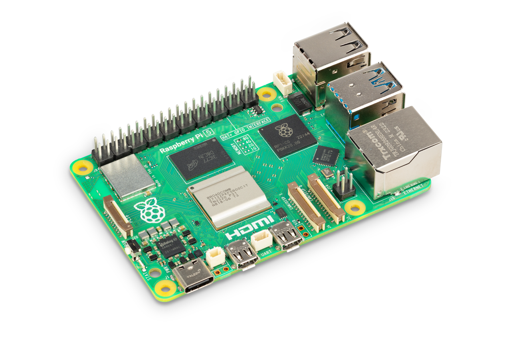
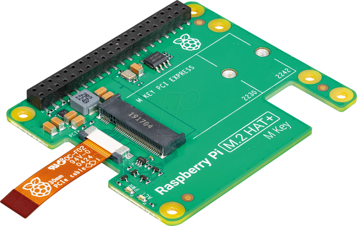
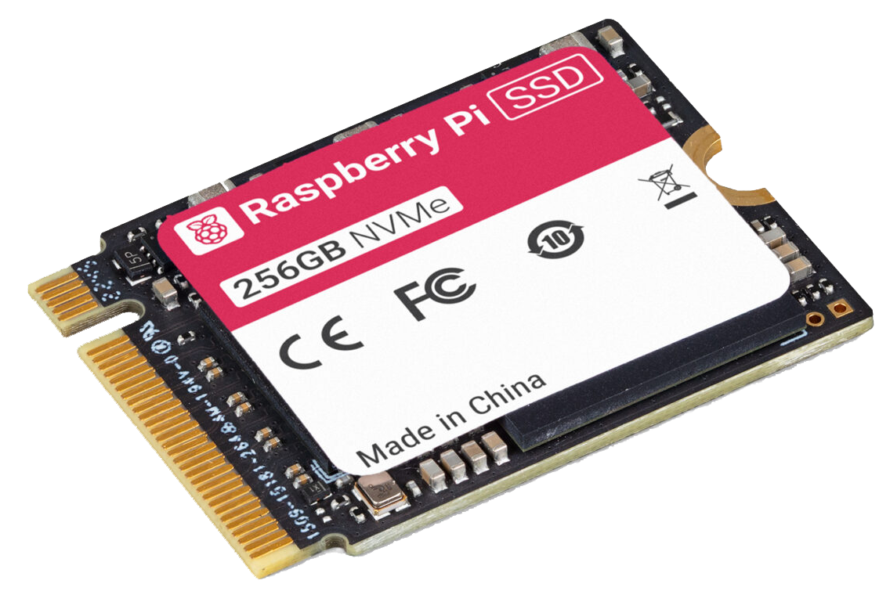
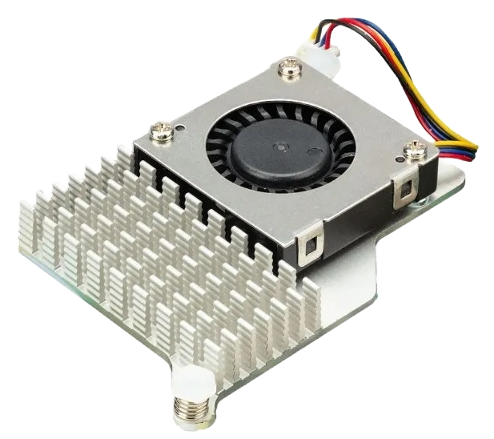
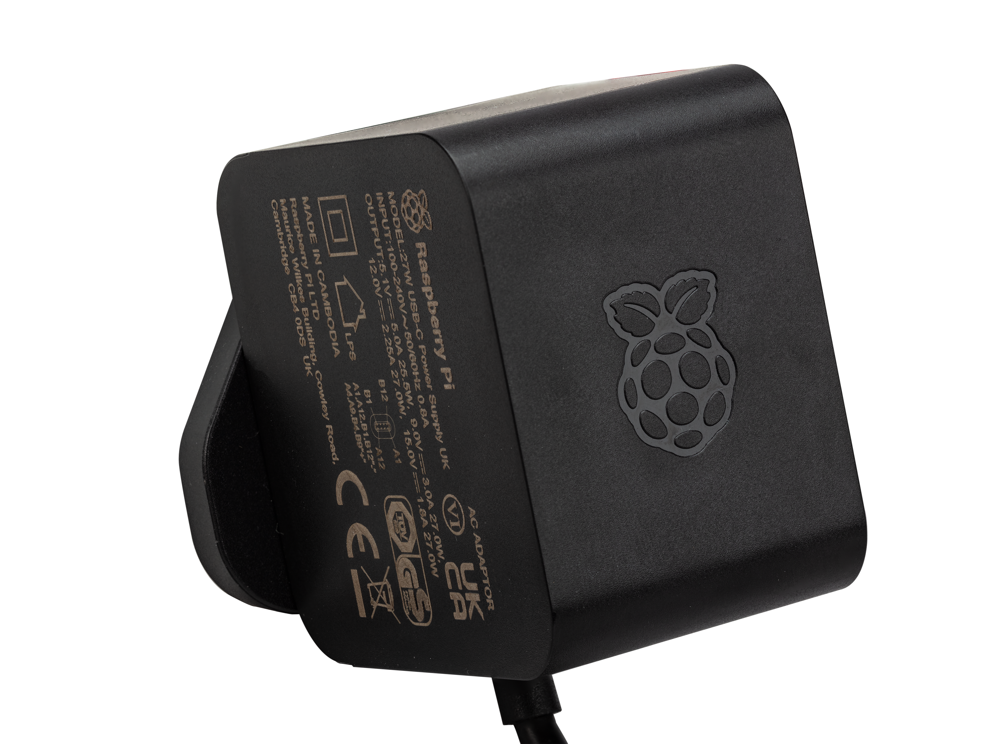
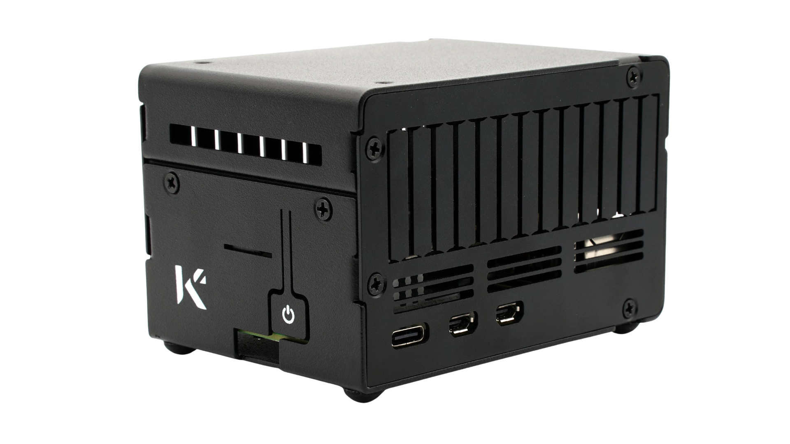

# Hardware Used

## Raspberry PI 5 (8GB RAM) | ~ $122 

    

Raspberry Pi 5 with 8GB RAM provides headroom to safely run
multiple services simultaneously.

---

## M.2 HAT+ for Raspberry Pi 5 | ~ $19

    

Required adapter for the NVMe SSD to be used on the Raspberry Pi 5.

---

## 256GB NVMe SSD Drive | ~ $50

    

The NVMe SSD provides faster PCIe-based data transfer speeds, better durability under constant writing, and faster overall system speeds than the MicroSD.

---

## Active Cooler | ~ $8

    

Active cooling to prevent thermal throttling and maintain stable operating temperatures during 24/7 operation.

---

## Raspberry Pi 27W USB-C Power Supply | ~ $22

    

Official Raspberry Pi power supply to ensure stable operation of the device and its peripherals.

---

## KKSB Case for Raspberry Pi 5 | ~ $22

    

A case adds a physical layer of protection and prevents dust collection.

---