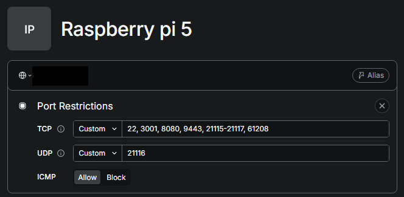
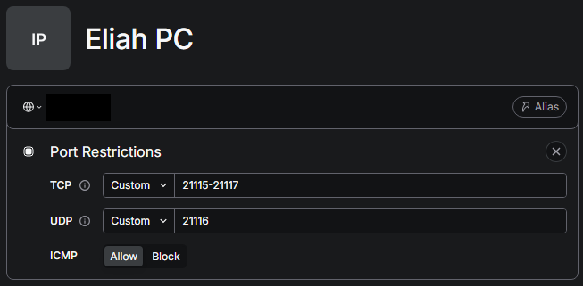

# Twingate

<p align="center">
    
</p>

I learnt about Twingate thanks to NetworkChuck's tutorial (link in [overview](overview.md)) and applied it to my lab for secure remote access to my network.

Twingate is a zero-trust platform, combining a secure split-tunnel to my home network, without exposing any internal services to the internet, like standard port forwarding would've done.

---

At the beginning, Twingate ran on Docker, and one time I was working remotely on my Raspberry Pi, and I wanted to restart the Docker compose.

Up until now, everything sounds normal, the problem was, that instead of just using the command:

```bash
docker compose up -d
```
to restart it, I firstly turned it off, then tried to turn it back on with the commands:

```bash
docker compose down
docker compose up -d
```
The problem is, because Twingate ran on Docker, the second I shut down the Docker compose file, I couldn't turn it back on :)

Since that incident, Twingate is running as a systemd service.

## Twingate Installation
For installation and initial setup, please refer to the [official Twingate documentation](https://www.twingate.com/docs/quick-start) or [NetworkChuck's tutorial](https://youtu.be/1lZ3FQSv-wI?si=gABHozIN5JXO33kr).

## Twingate Configuration
Systemd `.service` file shown [here](/configs/Twingate/twingate-connector.service.example)

Environment file is shown [here](/configs/Twingate/connector.conf.example)

### Resource Access

For the Raspberry Pi resource, I allow all the ports my services use.
<p align="center">
    
</p>

> [!NOTE]
>
> Twingate's port restrictions control traffic over the tunnel, while [UFW](/docs/security.md#firewall) controls traffic at OS level. 

In my own PC's resource, I only allow RustDesk's ports.
<p align="center">
    
</p>
